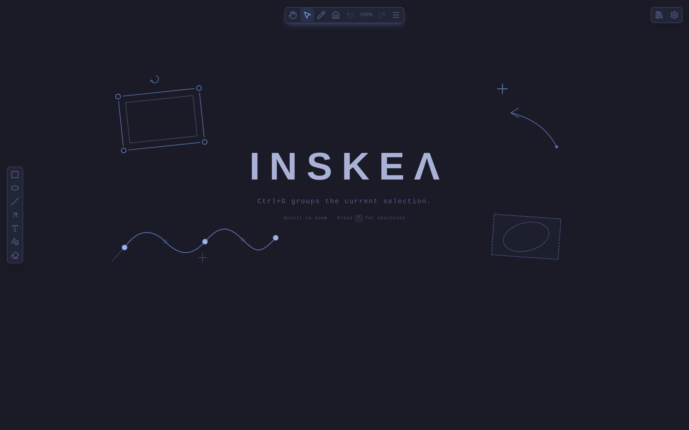
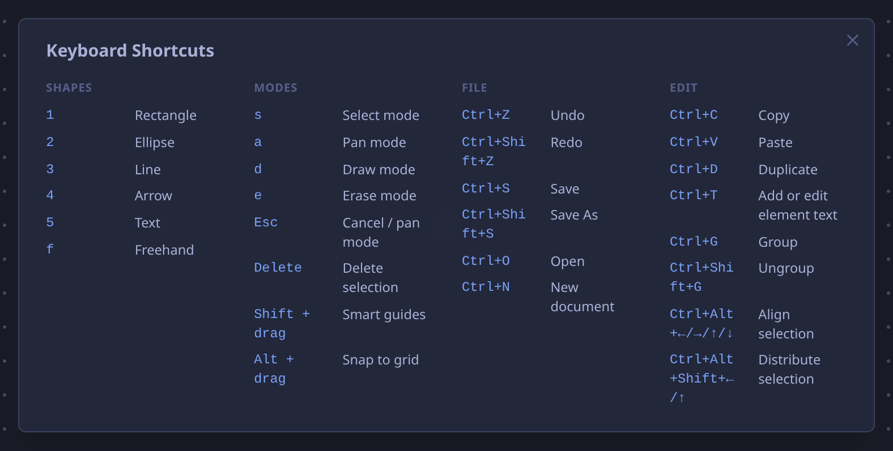

<p align="center">
  
</p>

<p align="center">
  <a href="https://www.npmjs.com/package/inskea"></a>
  
  
  <a href="LICENSE"></a>
</p>

---
Inskea is a drawing app without edges. One canvas that never runs out of room, for sketching diagrams, drafting ideas, and drawing by hand. When you finish, save your work to a real file and pick it back up later.

It runs as a native desktop app and in the browser, with the same tools and the same files either way. Designed for fluid one-handed use while drawing, so your other hand never has to leave the mouse or pen.

<p align="center">
  
</p>


## Features

### Draw & Style
- **Shapes & Freehand** – Rectangles, ellipses, straight/curved lines, and smoothed freehand sketching.
- **Smart Connectors** – Dynamic endpoints that snap to shapes, track movement, and route with direct, curved, or orthogonal paths.
- **Images & Text** – Place and transform images (PNG, JPEG, GIF, WebP, SVG, BMP) or label shapes (`Ctrl+T`).
- **Styling** – Color palettes, fills, stroke widths, opacity levels, and dashed/dotted lines.

### Arrange & Canvas
- **Infinite Canvas** – Boundless pan and zoom (10% to 2000%) with customizable grid and center markers.
- **Transform & Align** – Multi-selection, 8-handle resizing, live Alt-snapping, smart alignment guides, and even distribution.
- **Groups & Layers** – Group elements with in-place nested editing and z-order layering.
- **Themes** – Tokyo Night, Storm, Paper, Greenboard, and Mono.

### Files & Export
- **`.skea` Format** – Fully editable, non-destructive file format.
- **Autosave** – Background autosaving to local files or browser storage.
- **Export** – High-resolution PNG and clean vector SVG exports with crop area selection.
- **Cross-Platform** – Seamless native desktop app (Linux, Windows) and web browser support.

## Installation

### Via npm (Linux & Windows)

```bash
npm install -g inskea
```
```bash
npm update -g inskea
```

*(You can also run it instantly without installing: `npx inskea`)*

### Native Installers

Download pre-built installers for Windows (`.exe`), Debian/Ubuntu (`.deb`), or Arch Linux from [Releases](https://github.com/Quippy22/Inskea/releases).

## Keyboard shortcuts

Press `?` anywhere in the app to view the shortcut overlay.

<p align="center">
  
</p>

